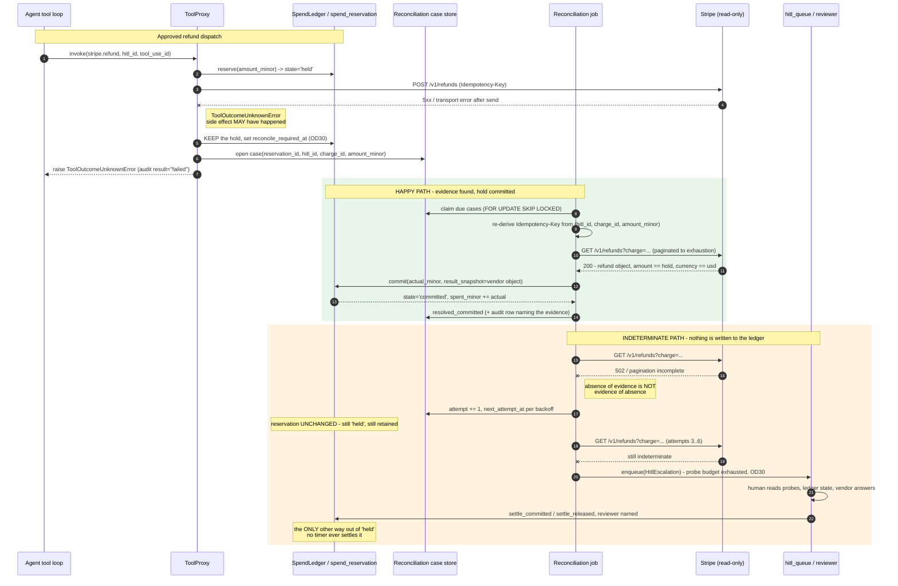

# Idempotency-Key reconciliation of retained spend holds

Status: **DESIGN ONLY. NOTHING HERE IS LIVE.** No code, no migration and no
scheduled job described below exists. Going live requires owner approval (see
section 11).

Owner ruling this document implements -- **OD30**: *a spend hold is released ONLY
on reconciliation evidence, NEVER by the passage of time.*

> OD30 is recorded, at `docs/decisions/2026-11-07_owner_rulings.md:247`, but on
> the branch `feat/decision-records-20261120` only -- not on `main`, where that
> file is titled "Owner rulings OD1-OD15 (+ OD3-AMEND)" (line 1) and stops at
> OD26-OD27 (`docs/decisions/2026-11-07_owner_rulings.md:191`). The recorded text
> matches the ruling implemented here and adds that the implementation "is a
> separate run; this is the decision record only". Landing that branch is the
> first open item in section 11.

Section map (the brief's ten required sections, plus section 2, which is the gap
the whole document exists to answer): 1 problem statement, 2 the sweeper gap,
3 trigger, 4 data sources, 5 where the Idempotency-Key comes from, 6 release
conditions, 7 partial and contradictory results, 8 HITL escalation, 9 failure
behaviour, 10 sequence diagram, 11 open items and owner approval.

Vocabulary is inherited from `docs/architecture/spend_reservation_replay_semantics.md`
(the four reservation states, `replay_key`, `result_snapshot`, "live-or-settled")
and is not redefined here.

**Which ledger this is.** The hold under discussion is a `spend_reservation` row
against a `spend_envelope` ceiling, denominated in currency MINOR units -- the
`budget_ledger` family of ADR-0006 (`docs/architecture/adr/0006-ai-cost-ledger.md`).
It is NOT `ai_cost_ledger` (money value of consumed LLM tokens, MICRO units) and
NOT `run_ledger` (in-flight token ceiling). Nothing in this design reads or writes
either of those two. `ToolSpendProfile`'s docstring states the unit directly:
`amount_field` carries "the amount in integer MINOR units (cents), the same unit
`SpendEnvelope` and `budget_ledger` use" (`src/skylize/tools/base.py:135-138`).

---

## 1. Problem statement

### 1.1 What an outcome-unknown failure is

`ToolOutcomeUnknownError(ToolExecutionError)` exists on branch
`origin/feat/integrity-typed-outcome` at `src/skylize/tools/base.py:715`, and its
docstring is the premise of this document: "The side effect MAY have happened; the
tool cannot tell (owner ruling OD4)... Raised when a non-idempotent write was
possibly delivered but no definitive answer came back (a 5xx, or a transport error
after the request may have been sent). The caller must VERIFY the outcome before
any retry, never blindly re-run."

That is a third disposition. The gate vocabulary in this repo has carried two --
it worked, or it was denied -- and the audit result literal still reflects exactly
that plus "failed": `result: str  # success|denied|escalated|failed`
(`src/skylize/app/audit/service.py:47`).

### 1.2 The state the system is left in

For a spend-capable tool (`tool.spend is not None`, checked at
`src/skylize/tools/proxy.py:461`), the proxy places the hold as the last gate
before dispatch (`src/skylize/tools/proxy.py:472-476`, reserving through
`_reserve_spend` at `src/skylize/tools/proxy.py:1044`). When the handler then
raises an outcome-unknown error, the facts on the ground are:

| Fact | Where it lives | Verified at |
|---|---|---|
| A reservation row in `state='held'` | `spend_reservation` | `migrations/versions/0019_principal_authority.py:158-159` |
| `spend_envelope.reserved_minor` still incremented by the hold | `spend_envelope` | `src/skylize/dal/spend_reservation.py:89-95` (the reserve CTE), undone only by commit/release/sweep |
| `committed_minor IS NULL`, `settled_at IS NULL`, `result_snapshot IS NULL` | same row | `migrations/versions/0019_principal_authority.py:155,163`; `migrations/versions/0030_spend_reservation_replay_key.py:95-96` |
| `expires_at = created_at + 15 minutes` | same row | `DEFAULT_HOLD_TTL = timedelta(minutes=15)`, `src/skylize/app/principal/spend.py:50` |
| An audit row with `result="failed"` and a free-text `result_reason` | `audit_log` | `src/skylize/tools/proxy.py:499-503`; `src/skylize/app/audit/service.py:41-57` |
| No record anywhere of the vendor object the call may have created | -- | see section 4.3 |

And one fact that is not recorded anywhere: whether the money moved.

### 1.3 Why the hold must stay

`release` means, and can only mean, "nothing was spent". Its SQL moves the row to
`state='released'` and decrements `reserved_minor` with no increment to
`spent_minor` (`src/skylize/dal/spend_reservation.py:336-352`). Writing that row
after an outcome-unknown failure is an assertion the system is not entitled to
make.

Three consequences follow from making it anyway, in increasing order of severity:

1. **The ledger misreports.** `spent_minor` omits a refund that may have left the
   business. Every ceiling computation downstream is then wrong by that amount.
2. **The ceiling stops binding.** The hold is the only thing reserving that
   capacity. Released, the same envelope will authorise a second refund of the
   same charge within the same period. The envelope ceiling is the *only*
   enforcement boundary on how much money an agent can move --
   `src/skylize/app/principal/spend.py:5-17` is explicit that a token cannot
   enforce it, so there is no second line of defence underneath.
3. **The audit trail disagrees with the vendor.** A reconciling human finds a
   released hold and a real refund, with nothing linking them.

Today the proxy does release it. The handler-error branch at
`src/skylize/tools/proxy.py:494-505` calls `_release_spend` and then flattens the
exception into `ToolExecutionError`, so **any** failure, an ambiguous timeout
included, frees the hold. The comment there states the intent plainly: "The hold
MUST NOT outlive the call it was placed for. Without this a failing tool leaks
budget until `sweep_expired` reclaims it at `expires_at`, and the customer sees
spend capacity vanish for 15 minutes with nothing to show for it"
(`src/skylize/tools/proxy.py:495-498`). That reasoning is correct for a definite
failure and wrong for an indeterminate one, which is the whole change.

Two stacked PRs in this run alter that branch so an outcome-unknown error keeps
the hold and names reconciliation in the audit reason. The first is visible:
`origin/feat/integrity-typed-outcome` adds a re-raise that preserves the subclass
(diff at `src/skylize/tools/proxy.py:503-510` on that branch) while leaving the
`_release_spend` call untouched -- so on that branch the hold is still released.
The second half, the one that actually retains the hold, now exists as two
stacked branches from this run: `feat/timeout-hold-contract-45` (commit `9c4019c`,
stacked on #45) and `feat/timeout-hold-contract-43` (commit `1e0d1e7`, stacked on
#43), which carry byte-identical `src/skylize/tools/proxy.py` and
`src/skylize/tools/base.py`. On `ToolOutcomeUnknownError` the hold is NOT released,
and the audit row carries `result="failed"` with a `result_reason` beginning with
the module constant `OUTCOME_UNKNOWN_HOLD_RETAINED` ("OUTCOME UNKNOWN, spend hold
retained pending reconciliation (OD30);") followed by `reservation=<uuid>`.
Everything below is written against that contract, which is now also the code on
those two branches -- neither is merged.

---

## 2. The sweeper gap: why OD30 is violated today even with the hold retained

**This is the gap this document exists to answer.** Retaining the hold in the
proxy is not sufficient, because something else releases it fifteen minutes later.

`sweep_expired` (`src/skylize/dal/spend_reservation.py:391-430`) runs, per org,
inside an RLS-bound transaction:

- it selects `WHERE state = 'held' AND expires_at < now` with
  `FOR UPDATE SKIP LOCKED` (`src/skylize/dal/spend_reservation.py:415-417`);
- it sets those rows to `state='expired', settled_at=now`
  (`src/skylize/dal/spend_reservation.py:411-412`);
- it then decrements `spend_envelope.reserved_minor` by `amount_minor` for each
  (`src/skylize/dal/spend_reservation.py:425-429`).

A hold the proxy deliberately retained matches that predicate on the dot. Fifteen
minutes after reservation it is swept, the budget is handed back, and the system
has released a hold on nothing but a clock. That is precisely what OD30 forbids,
and it happens with no change to the proxy at all. Any statement that "the proxy
keeps the hold" is false while this sweeper is unmodified.

> Incidental, and material to how urgent this is: `sweep_expired` has **no
> production caller**. Searching `src/` finds the definition
> (`src/skylize/app/principal/spend.py:106`, `src/skylize/dal/spend_reservation.py:391`)
> and references inside docstrings and comments, and every invocation is in
> `tests/`. Its own docstring says "Run from Temporal on a schedule, not from a
> request path" (`src/skylize/dal/spend_reservation.py:392-393`), but no schedule
> exists: the only Temporal schedule the repo creates is the autonomous agent run
> (`scripts/create_autonomous_schedule.py:3-8`). So the time-based release is
> currently latent rather than live. It is still a defect to fix before retention
> ships, because the fix belongs with the feature that depends on it, not with
> whoever eventually turns the sweeper on.

### 2.1 What marks a hold as "retained pending reconciliation"

Two shapes were considered.

**Option A -- a fifth reservation state, `reconciling`.** The sweeper's predicate
(`state = 'held'`) then skips it with no change at all. Rejected. The four-state
vocabulary is load-bearing in at least four places that would all silently change
meaning: the CHECK constraint
(`migrations/versions/0019_principal_authority.py:158-159`), the `Literal` on the
model (`src/skylize/app/principal/models.py:261`), the partial unique replay index
over `('held','committed')`
(`migrations/versions/0030_spend_reservation_replay_key.py:115-117`), and the
`state='held'` predicate that makes `commit` and `release` conditional and
therefore idempotent (`src/skylize/dal/spend_reservation.py:258`, `:339`). A new
state makes `commit` and `release` unable to settle the row that most needs
settling, and makes the replay index stop blocking a replay of exactly the call
whose outcome is unknown -- the worst possible moment to stop blocking it.

**Option B -- RECOMMENDED. Keep `state='held'`; add a nullable marker column.**

```
spend_reservation.reconcile_required_at  TIMESTAMPTZ NULL
```

Non-NULL means: this hold is retained pending reconciliation evidence under OD30,
and `expires_at` is informational for it. Everything else keeps working unchanged
-- `commit` and `release` still match `state='held'`, the replay index still sees
the row as live and still blocks a replay, and the state vocabulary is untouched.

The sweeper learns to skip it by one added conjunct:

```
WHERE state = 'held' AND expires_at < $1 AND reconcile_required_at IS NULL
```

and the sweep index should carry the same predicate so the scan stays tight. It
is today `CREATE INDEX spend_reservation_sweep ON spend_reservation (expires_at)
WHERE state = 'held'` (`migrations/versions/0019_principal_authority.py:169-170`).

**A schema change is OUT OF SCOPE for this run.** Option B requires a migration
(the column, the re-created partial index, a column comment) and a one-line change
to the sweeper's SQL. Both are required follow-up work, listed in section 11. No
migration is written here.

### 2.2 What bounds the retention

OD30 forbids release by the passage of time. It does not forbid *escalation* by
the passage of time, and the distinction is the entire answer to "what stops a
stuck case holding a customer's budget forever".

| Bound | Age | What happens | What does NOT happen |
|---|---|---|---|
| Probe budget | 6 attempts within 24h (section 3.3) | the case is escalated to a human | no state change to the reservation |
| Attention bound | 24h retained and still indeterminate | HITL case raised (section 8) | nothing is released |
| Visibility bound | 72h retained | the case is surfaced as an operator alarm alongside the HITL item | nothing is released |
| Envelope pressure | retained holds exceed a configured share of a `spend_envelope` ceiling | a containment-style escalation, following the auto-hook precedent fired on `CeilingExceeded` at `src/skylize/tools/proxy.py:1133-1141` | nothing is released |

So the bound on retention is a human SLA plus visibility, never a timer that
settles the ledger. A retained hold leaves `held` only when a process -- the job,
with vendor evidence, or a named human reviewer -- writes `commit` or `release`
with a reason. Thresholds in the table are recommendations for owner review, not
findings.

---

## 3. Trigger

### 3.1 Three candidate triggers, and the recommendation

| Trigger | Verdict |
|---|---|
| Scheduled sweep over all retained holds | **Yes, as the processing loop.** |
| Event-driven on the audit row | **No.** See 3.2. |
| Event-driven on case creation at retention time | **Yes, as the enqueue.** |
| On-demand, operator-invoked for one case or one org | **Yes, as an escape hatch.** |

Recommended composition: the proxy, at the moment it retains a hold, writes a
durable reconciliation case; a scheduled worker processes open cases; an operator
can force a single case or a single org's cases immediately.

### 3.2 Why not event-driven on the audit row

The audit row is the right *signal* and the wrong *source*. `AuditService.record`
hashes both payloads before writing: `inputs_hash` and `outputs_hash` are SHA-256
hex and nothing else (`src/skylize/app/audit/service.py:29-33`, `:59-61`,
docstring at `:10-11`: "Inputs/outputs are recorded as SHA-256 hashes only -- PII
never enters the audit trail in clear"). The proxy's audit call passes
`inputs={"tool_id": tool_id}` (`src/skylize/tools/proxy.py:1344` in
`_audit_call`), so even the tool id arrives hashed. `AuditRow` carries no
reservation id and no vendor object id (`src/skylize/dal/ports.py:53-66`), and the
only read on the repository is `list_for_org`, newest-first with a `before` cursor
(`src/skylize/dal/ports.py:116-123`) -- there is no query by result, by reason
prefix, or by correlation id.

A reconciliation job driven off audit rows would therefore have to page the whole
org feed, string-match `result_reason`, and then still be unable to learn which
charge to ask the vendor about. The stable `result_reason` prefix the retention PR
adds stays valuable for human search and for an alerting rule. It is not the job's
input.

### 3.3 Cadence

The vendor's own record may lag the write that created it, so the first probe
should not be instant. Recommended attempt schedule per case, each attempt
read-only: **+1 min, +5 min, +15 min, +1 h, +6 h, +24 h**, then stop probing and
escalate. Six attempts, one day, then a human.

The worker should run on a fixed tick (recommended: every 60 seconds) and claim
due cases, rather than each case holding its own timer. Cases are claimed with
`FOR UPDATE SKIP LOCKED`, the same device the sweeper already uses
(`src/skylize/dal/spend_reservation.py:417`).

### 3.4 The schedule is an explicit operator on-switch

This repo has a precedent and it should be followed. `scripts/create_autonomous_schedule.py:3-8`
states it: "THIS SCRIPT IS THE ON SWITCH. Nothing else in the repo starts an
autonomous run: the composition root builds the service but registers no trigger,
and the Temporal worker registers the workflow without starting it. Paid, governed
work that runs while nobody is watching should require somebody to deliberately
turn it on, name the org, and see the cadence printed back."

A job that settles money ledgers against a vendor is exactly that kind of work.
Registering the worker must not start it; a named operator action per org must.
That script's other properties are worth copying too: a pre-flight that refuses to
install a cadence it cannot resolve, a `--dry-run`, and an idempotent schedule id
(`scripts/create_autonomous_schedule.py:13-23`).

---

## 4. Data sources

### 4.1 Where the open holds come from

`spend_reservation`, read per-org, filtered to `state = 'held' AND
reconcile_required_at IS NOT NULL` -- the exact complement of the sweeper's
predicate after section 2.1.

The read must bind the RLS GUC per org and must not attempt one unscoped query.
`spend_reservation` is in the FORCE RLS set with a `tenant_isolation` policy on
`org_id = current_setting('skylize.org_id', true)`
(`migrations/versions/0019_principal_authority.py:242-252`), and under the
non-superuser `skylize_app` role an unscoped query matches no rows rather than
erroring. `sweep_expired` already demonstrates the correct shape: loop over
`org_ids`, one transaction each, `SELECT set_config($1, $2, true)` first
(`src/skylize/dal/spend_reservation.py:400-408`).

### 4.2 Where the vendor's truth comes from

Stripe, read-only, through the existing transport shape:
`StripeRefundExecutor.get_charge_currency`
(`src/skylize/app/stripe/actions.py:166-191`) is a GET to
`{api_base}/charges/{charge_id}` with `Authorization: Bearer <platform key>` and
`Stripe-Account: acct_...`, and its docstring records the authority position --
"design 7.0's own table says reads need no additional authorization beyond that"
(`src/skylize/app/stripe/actions.py:170-174`). A reconciliation read needs nothing
more: no new credential, no per-tenant token (none is stored --
`src/skylize/app/stripe/actions.py:4-8`), no new scope.

**No read-only "list refunds" capability exists anywhere in the repository.**
Verified: every occurrence of `refunds` under `src/` is either prose or the single
`POST {api_base}/refunds` at `src/skylize/app/stripe/actions.py:240`. So this is
new work, and it is the smallest new surface the design needs:

- `list_refunds_for_charge(stripe_account_id, charge_id)` -- GET
  `/v1/refunds?charge=...`, paginated to exhaustion, same two headers;
- `retrieve_refund(stripe_account_id, refund_id)` -- GET `/v1/refunds/{id}`, for
  confirming a single object.

Both read-only, both new, neither written here. A refusal to answer (non-2xx,
transport error, pagination that cannot be completed) is an indeterminate result,
never an absence -- see section 7.

> **A deliberate non-use of the Idempotency-Key.** Replaying the original POST with
> the same `Idempotency-Key` would resolve the ambiguity, because the vendor returns
> the stored response for a duplicate key. The job must not do it. If the first
> request never reached the vendor, the same-key POST *creates* the refund: it
> converts "indeterminate" into "it happened" by making it happen, which is acting,
> not gathering evidence, and OD30 asks for evidence. A same-key retry remains
> available as a **human-authorized** action out of the HITL case (section 8), never
> as a step the job takes by itself. Note also that the local record has to outlive
> the vendor's key window: "Stripe additionally requires a LOCAL dedupe record
> beyond its own 24-hour idempotency-key window"
> (`src/skylize/app/stripe/actions.py:37-42`), which the recommended 24h probe
> budget in 3.3 deliberately sits inside.

### 4.3 The missing third source: case context

The job needs `(org_id, tool_id, charge_id, amount_minor, hitl_id,
stripe_account_id, reservation_id)` to probe anything. Almost none of it is
reachable from the retained hold:

| Field | On `spend_reservation`? | Recoverable? |
|---|---|---|
| `org_id`, `reservation_id`, `amount_minor` | yes (`migrations/versions/0019_principal_authority.py:149-165`) | -- |
| `correlation_id` | yes (`:156`) | but it is the replay run's FRESH id, minted per approval attempt (`src/skylize/app/hitl/service.py:187`), so it does not identify the ticket |
| `tool_id` | no | embedded in `idempotency_key`, which is `f"tool:{tool.tool_id}:{uuid4()}"` (`src/skylize/tools/proxy.py:1124`). Parseable, but parsing a key to recover a field is not a data model |
| `charge_id` | no | nowhere on the row |
| `hitl_id` | no | `replay_key` is `uuid5(ns, f"{hitl_id}:{tool_use_id}")` (`src/skylize/tools/base.py:121`), one-way; and it is NULL on every call that is not a resumed HITL turn (`src/skylize/tools/base.py:119-120`) |
| `stripe_account_id` | no | resolvable per org from `StripeAccountRepository` (`src/skylize/tools/builtin/stripe_tools.py:61`) |

`hitl_queue.request_json` / `resumption_json` do hold the approved input and are
written once at enqueue (`src/skylize/dal/hitl.py:102-130`), which makes them
trustworthy -- but they are keyed by `hitl_id`, and the reservation does not carry
it. The audit row cannot supply it either, for the hashing reason in 3.2.

**Therefore: the reconciliation case must be captured at retention time**, by the
same code path that decides to keep the hold, in the same transaction wherever
possible. Minimum contents: `org_id`, `reservation_id`, `tool_id`, `hitl_id`,
`vendor` ("stripe"), the vendor object identity the call targeted (`charge_id`),
`amount_minor`, `created_at`, `attempt_count`, `next_attempt_at`, `status`
(`open|resolved_committed|resolved_released|escalated`), and the last probe's
verdict. This is new persistent state and therefore part of the same required
migration as 2.1; out of scope for this run.

A corollary the design must handle rather than assume away: if the proxy crashes
between retaining the hold and writing the case, there is a retained hold with no
case, and under section 2 nothing will ever reap it. The job therefore also needs
an **orphan pass** -- retained holds with no open case -- which escalates straight
to HITL and never releases (section 9.4).

---

## 5. Where the Idempotency-Key comes from

### 5.1 The derivation

`idempotency_key_for` (`src/skylize/app/stripe/actions.py:124-132`):

```
uuid5(_IDEMPOTENCY_KEY_NS, f"{hitl_id}:{charge_id}:{amount_minor}")
```

with `_IDEMPOTENCY_KEY_NS = uuid5(NAMESPACE_URL, "skylize.stripe.refund_idempotency_key")`
(`src/skylize/app/stripe/actions.py:59`) -- its own namespace, so a derived key
from this system can never coincide with one from another
(`src/skylize/app/stripe/actions.py:55-58`). It is sent as the `Idempotency-Key`
header on the single authorized mutation
(`src/skylize/app/stripe/actions.py:244`).

The job does not store the key. It **re-derives** it from the case record's
`(hitl_id, charge_id, amount_minor)` using that same function, so a drift between
what was sent and what is searched for is impossible by construction. If any of
the three inputs is missing from the case, the case is not reconcilable
automatically and goes to a human (section 8).

### 5.2 Why it is retry-stable

Because `hitl_id` is stable across approval retries and nothing else on the path
is. `HitlQueueService.approve` mints a fresh correlation id per attempt
(`fresh_correlation = uuid4()  # K8`, `src/skylize/app/hitl/service.py:187`) and a
transient failure releases the row to `pending` so a human can retry, re-running
the whole agent run. `ToolContext.hitl_id`'s docstring states the consequence: "An
idempotency key derived from `correlation_id` would therefore differ on every retry
and defeat the provider-side deduplication it exists to trigger. `hitl_id` is
stable across those retries; that is the entire point of threading it here"
(`src/skylize/tools/base.py:76-82`). The refund handler passes `ctx.hitl_id`, with
that reasoning repeated at the call site
(`src/skylize/tools/builtin/stripe_tools.py:170-175`), and the executor refuses
outright when it is absent rather than falling back
(`src/skylize/app/stripe/actions.py:219-227`).

`charge_id` and `amount_minor` come off the frozen validated input
(`src/skylize/tools/builtin/stripe_tools.py:88-89`), and the approved input is
itself immutable: `request_json` is written once at enqueue and never rewritten
(`src/skylize/app/hitl/service.py:22-24`). So all three components are fixed for
the life of one approved decision, which is exactly the window reconciliation
operates in.

### 5.3 Three keys, three questions -- do not conflate

The same discipline the three ledgers get. Collapsing any two of these has already
caused one near-miss in this repo
(`docs/architecture/spend_reservation_replay_semantics.md` section 3A, "A trap this
section predicted, then walked into anyway").

| Key | Shape | Question it answers | Site |
|---|---|---|---|
| `Idempotency-Key` | `uuid5(ns, "{hitl_id}:{charge_id}:{amount_minor}")` | "is this the same vendor-side money movement?" | `src/skylize/app/stripe/actions.py:124-132` |
| `Reservation.replay_key` | `uuid5(ns, "{hitl_id}:{tool_use_id}")` | "is this the same logical tool call across a retry?" | `src/skylize/tools/base.py:121` |
| `spend_reservation.idempotency_key` | `f"tool:{tool_id}:{uuid4()}"` | "is this the same reservation ATTEMPT?" -- unique per attempt, deliberately | `src/skylize/tools/proxy.py:1124` and the comment at `:1103-1123` |

The reconciliation job uses the first to interrogate the vendor and the third
(indirectly, via `reservation_id`) to settle the ledger. It never derives one from
another.

---

## 6. Release conditions

The job reads; the ledger decides nothing on its own. Every path below ends in
exactly one of: `commit`, `release`, or no write at all.

### 6.1 Outcome 1 -- the side effect definitively happened

**Evidence required, all of it:** the vendor's refund list for that `charge_id`
contains an object whose `charge` matches, whose `amount` equals the hold's
`amount_minor`, whose `currency` equals the tool's declared currency
(`STRIPE_REFUND_CURRENCY = "usd"`, `src/skylize/tools/builtin/stripe_tools.py:82`),
and whose creation is attributable to this attempt -- the derived
`Idempotency-Key` in section 5.1 being the attribution.

**Action:** `commit`, not release. Money moved, so it must land in `spent_minor`.
`SpendLedger.commit(org_id, reservation_id, actual_minor=<vendor amount>,
result_snapshot=<the vendor object>)` (`src/skylize/app/principal/spend.py:170-192`).
`result_snapshot` is the right home for the vendor object: it is defined as "The
tool output this reservation paid for"
(`src/skylize/app/principal/models.py:272-275`), the settlement here is on the
vendor's word rather than the handler's, and `commit`'s SQL uses
`result_snapshot = COALESCE($5::jsonb, result_snapshot)` so it can never blank an
existing one (`src/skylize/dal/spend_reservation.py:256-257`).

The case record is then marked resolved, `reconcile_required_at` is cleared as part
of the same settlement, and an audit row is written -- `result="success"` with a
reason naming the reconciliation, the reservation and the vendor object. The
audit-before-settle ordering the proxy uses for the same reason applies
(`src/skylize/tools/proxy.py:515-524`).

**One hard precondition.** `commit`'s SQL is `committed_minor = LEAST($3,
amount_minor)` (`src/skylize/dal/spend_reservation.py:251`), and the only
validation above it is `actual_minor < 0`
(`src/skylize/app/principal/spend.py:185-186`). A vendor amount GREATER than the
hold is therefore silently clamped and the excess is never recorded anywhere --
despite the docstring saying "It may NOT be higher: over-spend is a policy event,
not a rounding detail" (`src/skylize/app/principal/spend.py:179-183`). The job must
never hand `commit` an amount above the hold. That case is a contradiction and goes
to section 7.

### 6.2 Outcome 2 -- the side effect definitively did not happen

**Evidence required:** positive evidence of absence, not merely a failure to find
anything. Concretely: a fully-paginated, 2xx refund list for that `charge_id`,
read at least once after the vendor's own consistency window has passed, that
contains no object attributable to the derived key; and a single-object retrieve
for the derived key that reports it unknown. Both, from a successful read.

**Action:** `release` (`src/skylize/app/principal/spend.py:204-211`). The
assertion "nothing was spent" is now backed by evidence, which is the one
circumstance OD30 permits it. The case is marked resolved,
`reconcile_required_at` cleared, and an audit row written naming the evidence.

A retry, if the business still wants the refund, is a separate governed call
through the normal path. It is not part of reconciliation, and reconciliation must
not trigger it.

### 6.3 Outcome 3 -- still indeterminate

**Action: nothing.** No ledger write, no state change, no `reconcile_required_at`
clear. The case's `attempt_count` is incremented and `next_attempt_at` is advanced
per the 3.3 schedule, and the probe verdict is recorded on the case for the human
who may later read it.

This is the default and it is what OD30 purchases. A job that cannot tell must
leave the hold exactly where it found it.

### 6.4 Summary

| Vendor evidence | Ledger write | Reservation ends in |
|---|---|---|
| Matching object found, amount == hold | `commit(actual = vendor amount)` | `committed` |
| Clean, complete, post-window read with no matching object AND key unknown | `release` | `released` |
| Anything else | none | stays `held`, stays retained |
| Contradiction (section 7) | none | stays `held`, HITL raised |

---

## 7. Partial and contradictory results

The governing rule: **absence of evidence is not evidence of absence.** Every
incomplete answer is outcome 3, never outcome 2.

### 7.1 Partial answers -- all indeterminate

| Situation | Treatment |
|---|---|
| Non-2xx from the vendor read | indeterminate; `get_charge_currency` already models the shape by raising on `status_code >= 400` (`src/skylize/app/stripe/actions.py:185-188`) |
| Transport error or timeout on the read | indeterminate |
| Pagination that cannot be exhausted | indeterminate; a partial page proves nothing about the pages not read |
| The charge itself cannot be read | indeterminate, and after the probe budget a HITL case, since an unreadable charge may mean a revoked connection |
| No Stripe connection for the org, or the account is not in the expected mode | indeterminate; escalate immediately rather than probing six times. The tool's own gate already refuses on both (`src/skylize/tools/builtin/stripe_tools.py:156-161`) |
| Case record missing one of `hitl_id`, `charge_id`, `amount_minor` | not reconcilable automatically; escalate immediately (section 5.1) |

### 7.2 Contradictions -- never auto-resolved

Each of these goes to a human with the conflict stated, and none of them results in
a ledger write by the job.

1. **Vendor amount != hold amount.** Below the hold is legitimate on the ordinary
   path -- that is what `actual_amount_field` exists for
   (`src/skylize/tools/base.py:144-150`) -- but on the reconciliation path the job
   is settling on the vendor's word with no handler report to agree with, so a
   mismatch is unexplained and a human should see it. Above the hold is worse: it
   would be clamped and lost (6.1), so it must never reach `commit`.
2. **Vendor currency != the tool's declared currency.** The ordinary path treats
   this as a defer-to-human and explicitly not a conversion
   (`src/skylize/tools/builtin/stripe_tools.py:176-184`). Reconciliation inherits
   that disposition.
3. **Two vendor objects attributable to one derived key.** The key is supposed to
   make that impossible; if it is observed, the premise of section 5 is broken for
   that case and no automatic settlement is safe.
4. **The reservation is no longer `held`.** Another process settled it while the
   case was open. Both `commit` and `release` match only `state='held'`
   (`src/skylize/dal/spend_reservation.py:258`, `:339`) and return silently on no
   match (`:268-269`, `:344-345`), so the job's write would be a silent no-op. The
   job must read the row's state and branch:
   - already `committed` and the vendor agrees -> the case is resolved, record it
     and close;
   - already `released` or `expired` while the vendor shows the refund HAPPENED ->
     **ledger integrity finding.** Money moved against a hold that was given back;
     `spent_minor` is understated. Escalate, and say so in those words.
5. **The vendor shows the refund but the case was raised against a different
   charge.** The case record and the vendor disagree about the target; escalate.

The precedent for treating a settlement disagreement as a human-facing fact, rather
than a log line, is already in the proxy: the settlement anomaly is computed before
the audit call specifically so it lands in the audit row, because "a settlement that
disagrees with the tool's own report is precisely the thing a human reconciling this
org's ledger has to be able to find"
(`src/skylize/tools/proxy.py:507-513`, and the log at `:534-537`).

---

## 8. HITL escalation

### 8.1 When

| Trigger | Section |
|---|---|
| Probe budget exhausted, still indeterminate | 3.3, 6.3 |
| Any contradiction | 7.2 |
| Case missing a key-derivation input | 5.1 |
| Vendor read capability unavailable or unauthorized for the org | 7.1 |
| Retained hold with no open case (orphan pass) | 4.3, 9.4 |
| Retention age bound reached | 2.2 |

Escalation changes the case's status and raises a human item. It does **not**
change the reservation. The hold stays `held` and retained until a human's verdict
settles it.

### 8.2 The entry point

`HitlQueueRepository.enqueue(HitlEscalation)` (`src/skylize/dal/ports.py:489`),
concretely `PgHitlQueueRepository.enqueue`
(`src/skylize/dal/hitl.py:65-130`). It writes the parent `decisions` row and the
child `hitl_queue` row inside one `tenant_session`, so "a hitl_queue row can never
reference a decision that was never written"
(`src/skylize/dal/hitl.py:66-70`). `HitlEscalation`'s fields are at
`src/skylize/dal/ports.py:414-454`.

Field values for a reconciliation case: `outcome="deferred_to_human"`,
`action_kind` naming the reconciliation, `proposal_json` carrying the case -- the
reservation id, the derived key, the vendor evidence so far, the attempt history,
and the conflict if there is one -- and `trigger_reason` naming OD30 and the
escalation trigger from 8.1.

### 8.3 The verdict surface is NOT the existing approve path

This needs stating because the obvious wiring is wrong.

`HitlQueueService.approve` replays stored work: it validates `request_json` into a
`HitlReplayEnvelope` and calls `AgentExecutionService.execute`
(`src/skylize/app/hitl/service.py:198-245`). A reconciliation case has no agent run
to replay, and approving one must settle a ledger row, not execute an agent.

Setting `request_json=None` to express "nothing to replay" does not work either:
`approve` claims with `require_request=True`
(`src/skylize/app/hitl/service.py:194`), and the claim's predicate includes `AND
($7::boolean IS FALSE OR request_json IS NOT NULL)`
(`src/skylize/dal/hitl.py:183`). So a null-request ticket can be **rejected but
never approved** -- it would sit pending until it expired, and the typed refusal
path would fire instead (`src/skylize/app/hitl/service.py:196-197`).

The design therefore needs a purpose-built reviewer surface whose verdicts are
`settle_committed(actual_minor, evidence)` / `settle_released(evidence)` /
`keep_open`, writing through `SpendLedger.commit` / `release` with the reviewer
named in the audit row. Whether that is a third verdict method on
`HitlQueueService` or a separate reconciliation service is an implementation
choice for the implementing PR, and either way it is new work, out of scope here.
What is not a choice: the existing `approve` path must not be reused, because it
would re-execute the tool call whose outcome is unknown -- the single most
dangerous thing this whole design exists to prevent.

### 8.4 What the human is shown, and what they may do

Shown: the charge, the hold, the derived key, every probe and its verdict, the
local ledger state, the vendor's answers, and the conflict in plain words. The
three verdicts above, plus one escalated option: **authorize a same-key retry** --
a deliberate human decision to resolve the ambiguity by re-sending the original
request with the same `Idempotency-Key`, accepting that it either returns the
stored response or performs the refund once. That option exists only here, only
with a named human, and never for the job.

---

## 9. Failure behaviour

### 9.1 The fail-closed position, stated once

**A reconciliation job that cannot prove an outcome leaves the hold exactly as it
is.** Every failure mode below resolves to that. The job has no path on which its
own error, crash, timeout, or doubt releases or commits anything. The customer-
visible cost of failing closed is reserved budget; the cost of failing open is an
unrecorded movement of real money and a ceiling that has stopped binding.

This is the same posture the ledger already takes: "FAIL-CLOSED: a missing
envelope, an expired period, a revoked envelope, and an exhausted ceiling are all
denials. Absence of budget is never unlimited budget"
(`src/skylize/app/principal/spend.py:18-19`).

### 9.2 The job raises, or crashes mid-run

Nothing is written, so the reservation stays `held` and retained, and the case stays
open with its attempt counter wherever it got to. The next tick picks it up. A
partially-processed batch is safe because each case is processed in its own
transaction and no case's resolution depends on another's.

Deliberately NOT inherited from `_release_spend`: that method swallows its own
errors because "An unreleased hold is not lost budget -- `sweep_expired` reclaims
it at `expires_at`" (`src/skylize/tools/proxy.py:1301-1322`, quote at `:1307-1309`).
That reasoning is sound in its place -- a best-effort release on a path where an
exception is already in flight -- and it is void for retained holds, because after
section 2.1 no sweeper reclaims them. A swallowed failure here is a case that stops
progressing, so the job logs and surfaces its failures rather than absorbing them.

### 9.3 Two runs concurrently

Three layers, all of them already-proven devices in this codebase:

1. **Case claiming.** Due cases are claimed with `FOR UPDATE SKIP LOCKED`, as
   `sweep_expired` claims holds (`src/skylize/dal/spend_reservation.py:415-417`).
   A second runner skips a claimed case rather than blocking.
2. **Conditional settlement.** `commit` and `release` both match `WHERE
   reservation_id = $1 AND org_id = $2 AND state = 'held'`
   (`src/skylize/dal/spend_reservation.py:258`, `:339`) and return silently when
   nothing matched (`:268-269`, `:344-345`). Two settlements of one reservation
   cannot double-decrement `reserved_minor`; the loser's UPDATE affects zero rows.
   `commit`'s own comment calls this out: "already settled -- commit is
   idempotent" (`src/skylize/dal/spend_reservation.py:269`).
3. **Duplicate probes are harmless** because every probe is a read.

So a double run costs extra vendor reads and settles nothing twice. Good enough;
the job should still refuse to start a second tick while one is running, for cost
rather than correctness.

### 9.4 The job never runs, or stops running

Retained holds accumulate and consume envelope capacity with nothing reclaiming
them -- the deliberate consequence of section 2. That must be visible, so the
retention count and the oldest retention age per org are first-class operational
signals, and the bounds in 2.2 fire from stored case ages rather than from job
liveness. The orphan pass of 4.3 is part of the same answer: a retained hold with
no open case is itself a job-failure symptom, and it escalates.

### 9.5 Vendor-side failure

Covered by 7.1: every vendor failure is indeterminate. The job must not interpret a
403, a 404 on a list endpoint, or a connection reset as "the refund did not
happen".

---

## 10. Sequence diagram

Both the happy path and an indeterminate path. Note that in the indeterminate path
no arrow ever reaches the ledger.



---

## 11. Open items / owner approval

**Nothing in this document is live.** There is no reconciliation job, no case
store, no retention marker, no sweeper change, and no vendor read capability. The
code cited is `main`'s code, which still releases the hold on every failure
(`src/skylize/tools/proxy.py:494-505`); the two stacked branches of this run change
that one branch of behaviour and are not merged. Going live requires owner approval
of the design and of each item below.

### Required follow-up work, in dependency order

1. **Land the OD30 record on `main`.** It is recorded at
   `docs/decisions/2026-11-07_owner_rulings.md:247`, but only on the branch
   `feat/decision-records-20261120`; `main` still stops at OD26-OD27.
2. **Land the retention change** in the proxy's handler-error branch, so an
   outcome-unknown failure keeps the hold and writes the stable `result_reason`
   prefix. Written and committed on `feat/timeout-hold-contract-45` (stacked on
   #45) and `feat/timeout-hold-contract-43` (stacked on #43); both still need
   review and merge, each after its own base PR.
3. **Migration (NOT written here):** `spend_reservation.reconcile_required_at
   TIMESTAMPTZ NULL` with a column comment, plus the re-created
   `spend_reservation_sweep` partial index carrying `AND reconcile_required_at IS
   NULL`, plus the reconciliation case table of 4.3.
4. **Sweeper predicate change:** add `AND reconcile_required_at IS NULL` to
   `src/skylize/dal/spend_reservation.py:415`. Until this lands, a retained hold is
   still released by the clock and OD30 is still violated.
5. **Read-only vendor capability:** `list_refunds_for_charge` and `retrieve_refund`
   on `StripeRefundExecutor`, same auth shape as
   `get_charge_currency` (`src/skylize/app/stripe/actions.py:166-191`). No new
   credential, no new scope.
6. **Classify Stripe failures as outcome-unknown.** On `main` every Stripe HTTP
   failure becomes a flat `ToolExecutionError`
   (`src/skylize/tools/builtin/stripe_tools.py:192-193`, raised from
   `src/skylize/app/stripe/actions.py:250-253`), and
   `origin/feat/integrity-typed-outcome` wires the new type for HubSpot only (its
   diff touches `src/skylize/tools/builtin/hubspot_tools.py`, not
   `stripe_tools.py`). `feat/timeout-hold-contract-43` adds the missing
   classification for the refund path: a new `StripeRefundOutcomeUnknown` on a
   post-send transport error or a status >= 500, mapped to
   `ToolOutcomeUnknownError` in the handler, with pre-send connect failures
   deliberately left as ordinary failures. Until it merges the refund path never
   raises the error this design triggers on, so the job would have nothing to
   reconcile.
7. **Reviewer surface for reconciliation verdicts** (8.3). The existing
   `HitlQueueService.approve` must not be reused.
8. **The job itself**, plus its operator on-switch following
   `scripts/create_autonomous_schedule.py`'s pattern (3.4).
9. **Over-amount commit:** decide whether `commit` should refuse an `actual_minor`
   above the hold instead of clamping it with `LEAST`
   (`src/skylize/dal/spend_reservation.py:251`), since the docstring already says it
   "may NOT be higher" (`src/skylize/app/principal/spend.py:179-183`). Not required
   for this design -- the job routes that case to a human either way -- but the gap
   is real and belongs on the record.

### Owner decisions this document does not make

- The probe schedule and attempt budget (3.3), the retention age bounds, and the
  envelope-pressure threshold (2.2) are recommendations, not findings.
- Whether a human may authorize a same-key POST retry out of the HITL case (8.4).
- Whether reconciliation applies to any vendor other than Stripe. Nothing here is
  Stripe-specific except section 4.2 and the key derivation in 5.1; the HubSpot path
  that already raises the typed error has no spend profile, so it places no hold and
  is out of scope.

### Noted, not acted on

- TODO (owner's own task, out of scope here): a stray `SKYLIZE_STRIPE_SECRET_KEY`
  check.
- Two stale claims found while verifying this document, both consistent with the
  repository's documented propagation failure mode. First: the replay work's
  migration is `migrations/versions/0030_spend_reservation_replay_key.py`, but it is
  called "migration 0028" in `docs/architecture/spend_reservation_replay_semantics.md`
  section 8, in `src/skylize/app/principal/models.py:267`, in
  `src/skylize/tools/proxy.py:1120-1121` and in
  `src/skylize/dal/spend_reservation.py:288`; `0028` is in fact
  `0028_org_autonomy_mode.py`. Second:
  `tests/integration/test_tool_proxy_replay_states_pg.py:87-91` says `sweep_expired`
  "never sets the RLS GUC its sibling methods set", but it does, at
  `src/skylize/dal/spend_reservation.py:406-408`. Neither is fixed here -- this is a
  documentation-only change -- and neither affects the design above.
